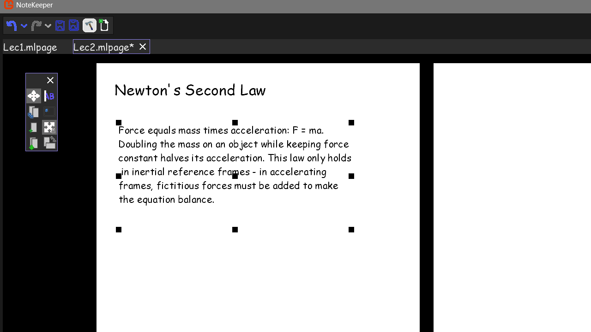

# NoteKeeper

A page-based note-taking editor for course notes, written in C# with MonoGame. 
Place text and images on canvas-style pages, edit them freely, and export the pages as PNG images.

## Features
- **Pages:** text blocks and images on a canvas-style page. Add text blocks and
  pages from the toolbar, and drag image files onto a page to add them.
- **Editing modes:** transform, write, and swap pages.
- **Undo/redo:** every edit is recorded in a history, with undo and redo buttons
- **Property explorer:** edit properties of the selected content as strings,
  integers or dropdown values.
- **Tabs:** several documents open at once, with a tab organizer, save and
  save-all buttons, and a prompt for unsaved changes when closing.
- **View:** Horizontal/vertical page views, zoom, whole-document editing
- **Architecture:** Extensible tab architecture with an abstract Tab class

## Requirements
- .NET 10.0
- MonoGame 3.8.0 or above (required by [PopUpUI](https://github.com/alpakca/PopUpUI))

## Build & run
1. Reference [PopUpUI](https://github.com/alpakca/PopUpUI) as a project reference.
2. Add `Icon.ico` and `Icon.bmp` to the project folder. They are not tracked in 
   this repository, but the project file uses them.
3. Compile the solution as it appears in the repo.
4. Before running the executable, copy the `assets` folder into the same
   folder as the compiled executable.

## Notes
Built solo in about 45 days (summer 2026) for personal use, so it is not
documented in depth. Only one tab type is implemented so far.

## License
All rights reserved. See [LICENSE](LICENSE) for terms — the source is
available to read and compile, but not to redistribute or modify.